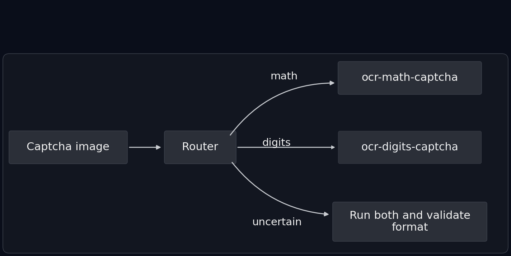

# OCR Captcha Router

[](https://huggingface.co/arkhabbazan/ocr-captcha-router)
[](LICENSE)

A lightweight captcha router that classifies a captcha image as **digits** or **math**, then lazily downloads and runs the matching TrOCR expert. Uncertain routes fall back to running both experts and picking the candidate that satisfies its grammar.



Model weights live on the Hugging Face Hub, not in this repository. `CaptchaResolver.from_pretrained` downloads the router and the selected expert on first use; Hugging Face caches them locally afterwards.

## How it works

1. **Route** — a ConvNeXt-tiny classifier (2 labels: `digits`, `math`) predicts the captcha type. The router input is letterboxed into 96×384 with the median corner color, so the original aspect ratio is preserved (`router_preprocess.json` holds the exact parameters).
2. **Run the expert** — a TrOCR model transcribes the image.
   - *digits*: beam search over up to three preprocessed views (original, autocontrast grayscale, inverted); the highest-scoring candidate matching `digit_pattern` wins. Decoding is not restricted to digit tokens: a token whitelist made the decoder append spurious digits (`9404` → `9404404`).
   - *math*: beam search, followed by repair of a truncated `a+b=` into `a+b=?`.
3. **Fallback** — if router confidence is below `router_confidence_threshold` (0.95) or the primary output fails its grammar, the other expert also runs and `choose_candidates` decides:
   - both valid and the router strongly favors math (probability ≥ `math_confidence_threshold`) → math
   - both valid otherwise → the digit candidate
   - exactly one valid → that one
   - neither valid → `route: "unknown"`, `valid_format: false`

A partial math match (`a+b=` without `?`) is never accepted on its own — the math expert can hallucinate `-` or `=` from captcha grid lines.

## Source models

| Role | Model |
| --- | --- |
| Router | [`arkhabbazan/ocr-captcha-router`](https://huggingface.co/arkhabbazan/ocr-captcha-router) |
| Math OCR | [`arkhabbazan/ocr-math-captcha`](https://huggingface.co/arkhabbazan/ocr-math-captcha) |
| Digit OCR | [`anuashok/ocr-captcha-v3`](https://huggingface.co/anuashok/ocr-captcha-v3) |

## Install

```bash
pip install -r requirements.txt
```

## Usage

```python
from resolver import CaptchaResolver

resolver = CaptchaResolver.from_pretrained(
    "arkhabbazan/ocr-captcha-router",
    token=True,
    math_confidence_threshold=0.85,
)
print(resolver.predict("captcha.jpeg"))
```

`predict` accepts a path or a `PIL.Image`, and returns:

```python
{
    "text": "3+4=?",
    "route": "math",
    "raw_router_route": "math",
    "router_confidence": 0.98,
    "router_probabilities": {"digits": 0.02, "math": 0.98},
    "math_confidence_threshold": 0.85,
    "used_dual_model_fallback": False,
    "selection_reason": "high-confidence router and valid primary output",
    "valid_format": True,
}
```

When the fallback runs, the result also carries `digits_candidate` and `math_candidate`.

Keep the captcha at its original aspect ratio — the resolver letterboxes only the router input and leaves OCR preprocessing to each TrOCR processor.

The router can also be used on its own, without the OCR experts:

```python
from router_inference import CaptchaRouter

router = CaptchaRouter("path/to/downloaded/repo")
label, confidence, probabilities = router.route(image)   # image: PIL.Image
```

## Configuration

`pipeline_config.json` holds the thresholds, expert model ids, and grammars:

| Key | Default | Meaning |
| --- | --- | --- |
| `router_confidence_threshold` | `0.95` | below this, run both experts |
| `math_confidence_threshold` | `0.85` | minimum router math probability to prefer math when both candidates are valid (0.0–1.0) |
| `digit_pattern` | `^\d{4,7}$` | valid digit output |
| `full_math_pattern` | `^\d+[+-]\d+=\?$` | valid math output |
| `partial_math_pattern` | `^\d+[+-]\d+=?$` | rejected on its own |

`math_confidence_threshold` can also be overridden per instance via `from_pretrained(..., math_confidence_threshold=...)`.

`token=True` uses your cached Hugging Face login (`huggingface-cli login`); pass a token string instead if you prefer. It is only needed for gated or private repos.

## Repository layout

| File | Purpose |
| --- | --- |
| `resolver.py` | `CaptchaResolver` — routing, expert execution, fallback |
| `pipeline_config.json` | thresholds, expert model ids, grammars |
| `router_inference.py` | standalone `CaptchaRouter` (route only, no OCR) |
| `config.json`, `router_preprocess.json` | router (ConvNeXt-tiny) model config and letterbox preprocessing parameters |
| `resolver-flow.png` | architecture diagram |

## License

Apache-2.0. See [LICENSE](LICENSE).
